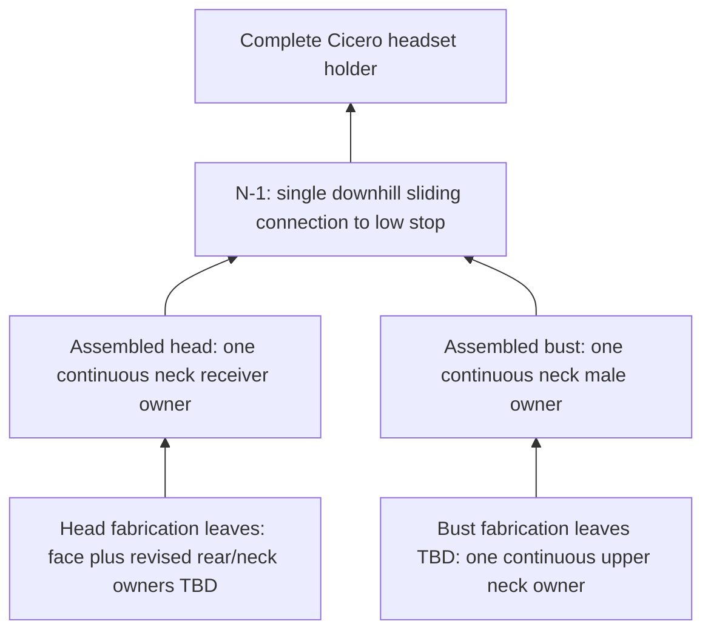

Current implementation: [complete integral-joint candidate](../cicero_joined/README.md).
The proposal below is historical; separate keys are rejected. The current design
has 17 body leaves, 33 integral mating pairs, one continuous neck owner per side,
and one head-to-bust dovetail. No loose connectors are permitted. Physical fit,
continuous sweeps, load capacity and global material-width checks remain unverified.

# Cicero joint architecture checkpoint

Status: historical seam-map checkpoint. Use [cicero_joined](../cicero_joined/README.md) for current geometry, ownership and evidence. The table below describes the retired five-piece fit study.
The current five head STLs remain body-fit references. This document records
what must change or be demonstrated before adding dovetails to all final cuts.
See the [gravity-seated dovetail protocol](../../references/engineering/joints/gravity_seated_dovetails.md)
and [flat-bed slicing playbook](../../playbooks/how_to_slice_large_objects_for_flat_bed_printing.md).

## Fixed requirements

- Steam Frame holder, uniformly scaled to 228.6 mm between selected ear rims.
- Printer 220 x 220 x 220 mm; current provisional XY margin 5 mm per side.
- Preserve the face in one piece, with facial features pointing up in its print
  pose and a broad actual rear cut face at Z=0. No elevated angular cut-face base.
- Assemble head pieces independently, assemble bust/base pieces independently,
  then attach head to bust through **one dovetail connection with one printed
  owner on each side** if feasible. Preserve continuous neck interface and
  support material; secondary cuts must avoid fragmenting those owners.
- Gravity-seated seams have an accessible entry and a closed lowest travel stop;
  define anti-lift retention separately. Prefer female-down/male-up in assembled
  coordinates where compatible with real insertion geometry. Vertical seams may
  use either ownership, but still require a downward seating direction.

## Measured current seam map

Assembly coordinates, millimeters; regions are stored in separate print transforms
in their STLs. Obtain those transforms from the current face-up report, not by
interpreting the print-coordinate axes as anatomy.

| ID | Current interface | Current boundary | Required disposition |
| --- | --- | --- | --- |
| H-F | Face to four rear regions | `n = [0.419962713, -0.890773613, -0.173648178]`, `n dot p = 25.611251491` | Keep face continuous; choose compatible downward installation paths for rear regions without trapping later pieces. |
| H-VL | Rear lower left/right | `n = [0.904515232, 0.426441315, 0]`, `n dot p = -15.536695772`, below Z=460 | Currently crosses neck attachment; revise/terminate this split to preserve a single neck owner. |
| H-VU | Rear upper left/right | Same lateral plane, above Z=460 | Choose female owner for material/printability; open vertical travel from above with low stop. Check H-F compatibility. |
| H-ZL, H-ZR | Rear lower/upper on each side | Z=460, rear only | Horizontal in-plane rails have no gravity drop. Develop an accessible seating mechanism or revise cut/path; female-down alone is insufficient. |
| B-* | Bust/base internal seams | Not selected; current base is one oversized intermediate | Choose print-flat cuts around one continuous upper neck owner; then enumerate every resulting seam individually. |
| N-1 | Complete head to complete bust | `Z = 0.3Y + 304.341422`, 16.699244 degrees from horizontal | One continuous interface, one owner per side, one connection; accessible downhill travel, low stop, retention and bearing lands. |

Read-only inspection of the installed `head_intermediate.stl` neck cap found
cap Z bounds 278.805115 to 333.672943 mm, below the Z=460 rear height split.
The cap occupies both sides of H-VL, in the rear region. Triangle-centroid
classification found no face-owned cap triangles; this is an ownership diagnostic,
not a proof of clearance for a connector or its supporting material. The current
rear lower leaves divide the neck interface and cannot be treated as a compliant
single neck owner. No new parts or altered cuts are asserted by this diagram.

The base remains three overlapping closed source shells. Resolve and verify the
intended solid union before claiming final connector attachment or load capacity.

## Intended hierarchy and assembly sequence

This is a conceptual dependency diagram, not an artifact-bound assembly approval
or a collision-verified assembly instruction. Head receiver/bust male is the
preferred arrangement, pending entry and thickness verification.

1. Reserve the full neck-contact region and enough surrounding material on one
   head leaf and one bust leaf. First evaluate terminating/rerouting H-VL outside
   that region; evaluate a continuous neck-bearing head section if necessary.
   Either option must keep real flat bed contact and fit after connectors. Neither
   has been demonstrated; do not promise the existing five-piece count survives.
2. Select bust subdivisions preserving its upper neck owner; verify the source
   union, print envelopes and stable bed faces before fixing a piece count.
3. Solve head internal seam directions as a group, using an installation graph
   and swept envelopes. Sequential left/right installation can conflict with a
   shared face's rails and horizontal rear joints. Integral mating features are required. Separate keys are rejected for Cicero.
4. Assemble bust and head independently using the verified orders. Put the bust
   in its intended upright pose; move the complete head through the N-1 path,
   seat it against the lower stop, then engage accessible anti-lift retention.
5. Reverse the sequence for service removal; verify hands, headset, ears and
   retainer access as well as connector clearances.

For a straight neck-plane slide, downhill is proportional to the projection of
`g=[0,0,-1]` onto the plane. With unit plane normal
`n=[0,-0.287347886,0.957826285]`, the unit downhill direction is approximately
`s=[0,-0.957826285,-0.287347886]`. Travel L therefore descends about `0.287347886 L`.
This establishes a direction candidate only: friction, anatomy, entry access,
stop location and the full moving head envelope still require verification.

## Superseded proposal and production gates

The two parallel head-owned rails in `neck_interface.json` are retained only as
historical diagnostic input. They do **not** implement the new single-connection,
single-owner architecture and are not approved production dimensions. Do not reuse
those two rails or their 60/24/32/8 mm envelope as a verified joint design. Preserve
the historical config bytes because existing reference provenance depends on them;
use a new production config when implementing the revised architecture.

Before jointed STLs, require:

- Demonstrated single-owner neck geometry on both sides, with final cut planes,
  contact/support material, joint envelope and fitting flat-bed transforms.
- Full head/bust seam inventory, exact owners, insertion paths, closed stops,
  assembly sequence and accessible retention without cyclic installation traps.
- Named wall/overlap/internal-width minima (current 3 mm values are targets),
  post-cut sections/ligaments and stop/rail-root connectivity. Gravity and a
  continuous interface do not establish a load rating; measure headset loads,
  contact geometry, padding needs and tipping stability.
- Production-derived joint coupons, calibrated fit, intended material/profile,
  final support allowances, slicer review and physical seating/retention tests.
- Production `parts.json` and `assembly.json`, imported-dependency provenance,
  complete manifest build/audit and installed-artifact assembly review. Existing
  source preservation/import/license files need declared handling in that pipeline.

Historical evidence: mutable `configs/rev_0001.json`, `face_up.json`, historical
`neck_interface.json`, and current intermediate/reference manifests. The current complete candidate implements joint geometry separately; no immutable
revision or physical strength result exists. Structural
joins and minimum internal material widths remain **unverified**.
